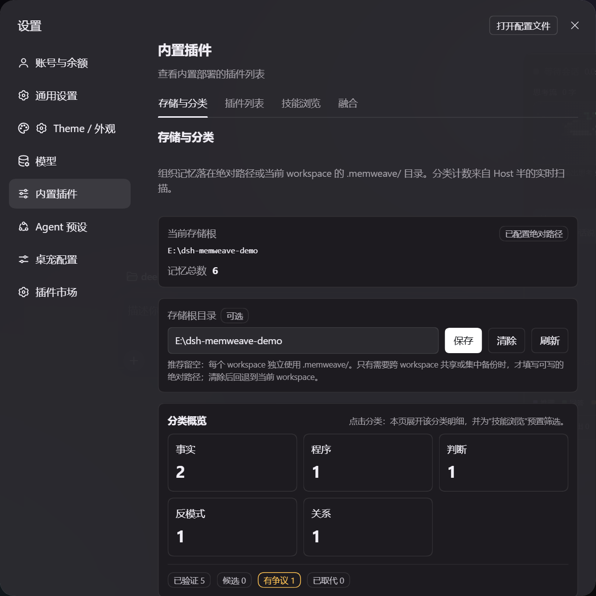
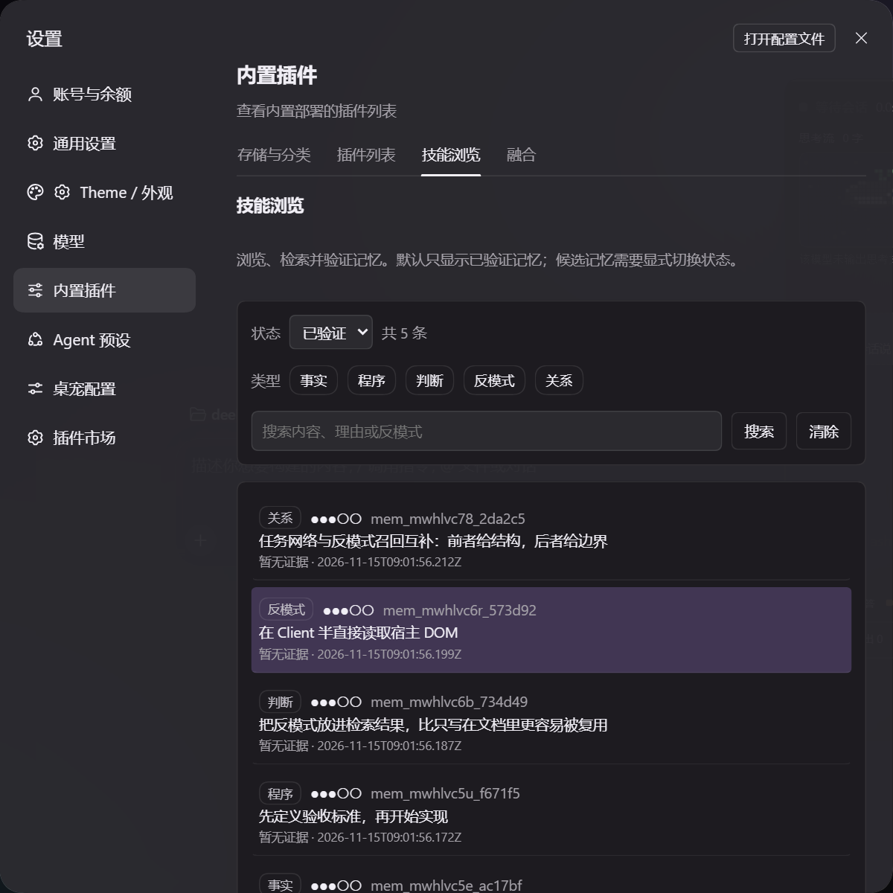
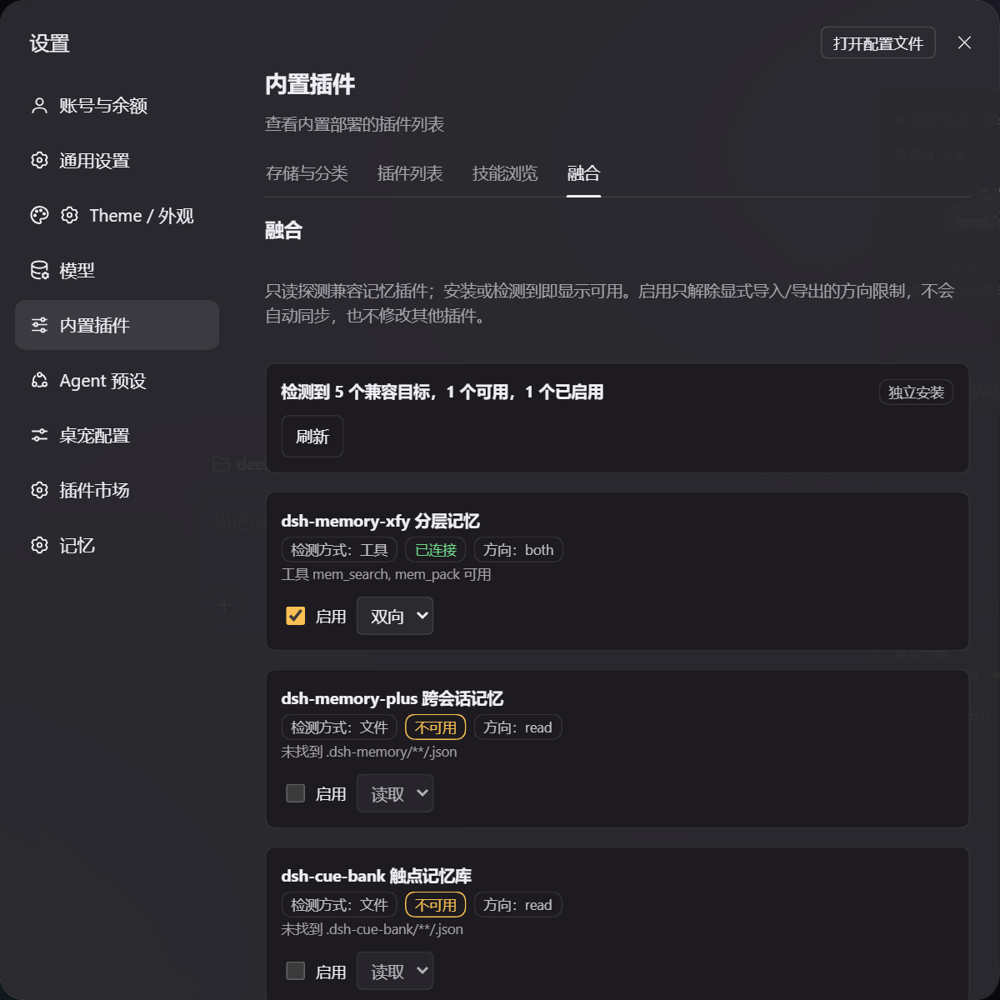
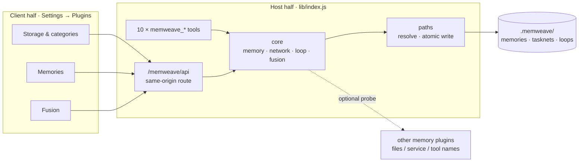
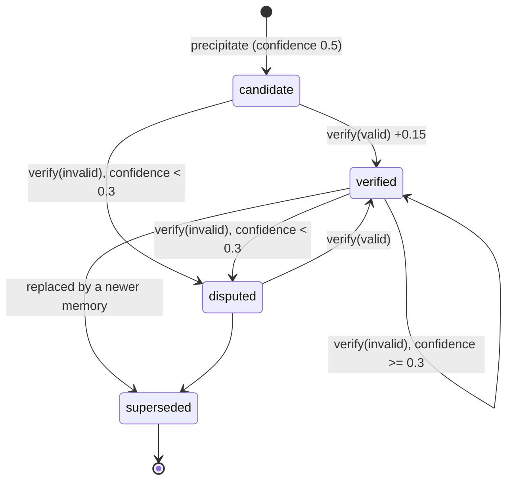

<p align="center">
  
</p>

<h1 align="center">Memweave <sub>dsh-memweave</sub></h1>

<p align="center">
  <b>Weave tasks, judgments, anti-patterns and measurable Loops into organizational memory.</b><br/>
  A verifiable, searchable and fusion-friendly DeepSeek Harness plugin.
</p>

<p align="center">
  
  
  
  
  
</p>

<p align="center">
  <a href="#quick-start">Quick start</a> ·
  <a href="./docs/USAGE.md">User guide (中文)</a> ·
  <a href="#tools">Tools</a> ·
  <a href="#settings">Settings</a> ·
  <a href="#architecture">Architecture</a> ·
  <a href="#screenshots">Screenshots</a> ·
  <a href="#fusion">Fusion</a> ·
  <a href="./DESIGN.md">Design</a> ·
  <a href="./CHANGELOG.md">Changelog</a> ·
  <a href="./README.md">中文</a>
</p>

<details>
<summary>Table of contents</summary>

- [Why Memweave](#why)
- [Highlights](#highlights)
- [Screenshots](#screenshots)
- [Architecture](#architecture)
- [Quick start](#quick-start)
- [Tools](#tools)
- [Settings](#settings)
- [Configuration](#config)
- [Storage and lifecycle](#storage)
- [Fusion](#fusion)
- [Aggregate layer](#aggregate)
- [Security and privacy](#security)
- [Development](#development)
- [Troubleshooting](#troubleshooting)
- [Roadmap](#roadmap)
- [Design](#design)
- [User guide (中文)](./docs/USAGE.md)
- [Contributing](#contributing)
- [License](#license)

</details>

---

<a id="why"></a>
## Why Memweave

Most “memory” features store chat history. Memweave asks a different question: **why should the next task trust a piece of experience?**

The three organizational-evolution principles are encoded directly in the tool contracts:

| Principle | Hard constraint |
|---|---|
| **Task-centered, not role-centered** | Task networks are the unit; nodes only carry `human / agent / hybrid`, never job titles |
| **Tacit knowledge, not manuals** | `judgment` must explain *why it works*; `anti_pattern` must explain *when it fails* |
| **Closed measurable loops** | A Loop requires a metric, target, unit and cadence; trends start at round three |

Two cross-cutting rules:

- **Anti-patterns first**: if a result set has no anti-pattern but a relevant one exists, the highest-scoring one is force-recalled.
- **Memory must be verified**: new memories are `candidate` and stay out of the default retrieval pool until `memweave_memory_verify(valid)` promotes them to `verified`.

---

<a id="highlights"></a>
## Highlights

| Icon | Capability | What it gives you |
|---|---|---|
| 🧠 | **Verifiable memory lifecycle** | `candidate → verified / disputed / superseded`, with confidence updates |
| 🪤 | **Forced anti-pattern recall** | Lessons from failures are not buried under success stories |
| 📈 | **Measurable Loops** | No metric, target, unit and cadence means no Loop |
| 🕸️ | **Task networks** | Goals become dependency-aware task nodes with anti-pattern warnings |
| 🖥️ | **Three settings tabs** | Storage & categories, memories, fusion — one Host data source |
| 🔌 | **Read-only fusion** | Works with other memory plugins without modifying or hijacking them |
| 🔒 | **Atomic local storage** | Exclusive temp file + `rename`; single-file writes are atomic |
| 📦 | **No third-party runtime deps** | Host uses DSH SDK + Node built-ins; Client uses host React only |

---

<a id="screenshots"></a>
## Screenshots

Captured from the real DSH 0.2.x Web UI. `Plugin list` is the settings shell's built-in tab; Memweave contributes the other three. The sample data is for demonstration only; the UI is localized to Chinese in these captures. See the [Chinese usage guide](./docs/USAGE.md) for step-by-step operations and more screenshots.

<details open>
<summary><b>Storage & categories</b>: absolute root, five category counts and status distribution</summary>



</details>

<details>
<summary><b>Memories</b>: status/type/keyword filters, list and verification entry point</summary>



</details>

<details>
<summary><b>Fusion</b>: read-only probes for five known compatible plugins, with direction controls (top three shown; scroll for all five)</summary>



</details>

---

<a id="architecture"></a>
## Architecture



| Half | Owns | Never does |
|---|---|---|
| **Host** | 10 tools, memory/task/Loop core, atomic storage, same-origin API, compatibility probes | render UI, bundle, obfuscate |
| **Client** | Three settings tabs, filters/details/verify/fusion controls, theme tokens | touch the filesystem directly, operate host DOM |

The only required Host dependency is `tools`. `webServer`, `configEditor` and every compatible plugin are optional probes: tools keep working when they are absent, and the settings UI states the degradation explicitly.

---

<a id="quick-start"></a>
## Quick start

### Requirements

- DeepSeek Harness Desktop **0.2.x** (desktop profile)
- A writable workspace
- No third-party runtime package installation from npm

### 1. Install

Call `plugin_manager` from DSH:

```json
{
  "action": "install_bundle",
  "target": "<absolute path to this repository>"
}
```

The default patch inserts only Memweave itself:

```yaml
- insert:
    - id: memweave
      name: dsh-memweave
```

### 2. Verify

| Check | Expected |
|---|---|
| **Settings → Plugins** | Tabs `Storage & categories`, `Memories`, `Fusion` |
| Model tools | 10 `memweave_*` tools |
| Default storage | `.memweave/` under the current session workspace |

> A normal Config change restarts the plugin by DSH lifecycle rules. If the settings tab briefly fails after saving a path, retry after a second — the UI already retries once.

### 3. Run one complete loop

```text
# 1. Decompose the goal
memweave_decompose("ship the plugin as an installable bundle")

# 2. Define a measurable Loop
memweave_loop_start(
  loopName="release cycle",
  metricName="lead time",
  metricTarget=3,
  metricUnit="days",
  cadence="weekly"
)

# 3. Record one round
memweave_loop_record(loopId, 5)

# 4. Precipitate the lesson
memweave_precipitate(
  type="judgment",
  content="register tools before building UI to catch contract errors earlier",
  rationale="defineTool validates schemas at registration time"
)

# 5. Retrieve and verify it next time
memweave_memory_find("plugin schema registration")
memweave_memory_verify(memoryId, "valid", "reproduced in task 42")
```

Trends appear only after three rounds: `improving / worsening / stable`. Before that, the result is `insufficient_data`.

---

<a id="tools"></a>
## Tools

All ten tools return canonical JSON only, and `output.render` emits exactly one text block.

| Tool | Category | Use when | Key constraint |
|---|---|---|---|
| `memweave_decompose` | Task network | Starting a task / decomposing a vague goal | Deterministic 6-node scaffold with `dependsOn` and `executor` |
| `memweave_precipitate` | Memory | A task ends, a judgment is found, a pitfall appears | `anti_pattern` needs `antiPatterns`; `judgment` needs `rationale` |
| `memweave_memory_find` | Memory | Designing a Loop / referencing past judgments | Searches `verified` by default; anti-patterns are force-recalled |
| `memweave_memory_verify` | Memory | You used a memory and know whether it worked | `valid` +0.15; `invalid` −0.25, below 0.3 becomes `disputed` |
| `memweave_memory_list` | Memory | Browsing / category counts / pagination | `summaryByType` always carries five keys |
| `memweave_loop_start` | Loop | Defining a measurable iterative process | Metric, target, unit and cadence are mandatory |
| `memweave_loop_record` | Loop | Each iteration completes | Trends start at three rounds; smaller is better in v1 |
| `memweave_fusion_status` | Fusion | Asking about compatibility / before import-export | Read-only probe; missing pieces degrade silently |
| `memweave_import` | Fusion | Explicitly importing from another memory plugin | `dryRun` writes nothing; real imports are `candidate`, confidence 0.4 |
| `memweave_export` | Fusion | Explicitly exporting a compatible format | Writes only `.memweave-exports/`, never another plugin's directory |

---

<a id="settings"></a>
## Settings

Open **Settings → Plugins**:

| Tab | What you can do |
|---|---|
| **Storage & categories** | Inspect the root, its source and status; save/clear an absolute path; see five category and four status counts; drill into a category |
| **Memories** | Filter by status/type/keyword; paginate; inspect details; verify as valid/invalid/inconclusive |
| **Fusion** | See detection method and availability for five known plugins; toggle fusion; choose read/write/both; inspect aggregate status |

The verify button and `memweave_memory_verify` share the same Host core — there is no second write path.

> Clicking a category expands its entries in place and presets the Memories filter. The settings shell does not expose a “switch tab” API to registrants, and Memweave never reads or operates host DOM.

---

<a id="config"></a>
## Configuration

Memweave exposes two fields through native DSH `Config`:

| Field | Type | Default | Meaning |
|---|---|---|---|
| `storageRoot` | string | `""` | Absolute memory root; empty means the current workspace `.memweave/` |
| `fusion` | object | `{}` | `{ "<pluginKey>": { enabled: boolean, direction: "read" \| "write" \| "both" } }` |

- `storageRoot` must be absolute; a relative path is rejected with `INVALID_ARGUMENT`.
- Clearing `storageRoot` falls back to `workspace/.memweave/`.
- Ordinary Config changes restart the plugin; this is DSH lifecycle behavior, not a plugin choice.
- The settings tabs persist through `configEditor`, never by rewriting the profile file.

---

<a id="storage"></a>
## Storage and memory lifecycle

### Layout

```text
<root>/
├── memories/<memoryId>.json
├── tasknets/<netId>.json
└── loops/<loopId>.json
```

### Lifecycle



- `candidate`: fresh memory; invisible to the default retrieval pool.
- `verified`: positively verified; enters the default pool.
- `disputed`: invalid and below 0.3 confidence; browsable but not searchable by default.
- `superseded`: replaced; archived, excluded from search, and rejected by verify.

> v1 has no automatic supersede tool; that state is maintained by a future version or manually. `precipitate` only returns an overlap hint and never replaces a memory on its own.

### Retrieval scoring

```text
score     = tfidf(query, memory) × trust × type_boost
trust     = confidence × (1 + 0.6 × (freshness − 0.5))
freshness = clamp(1 − ageDays(lastVerifiedAt ?? createdAt) / 90, 0, 1)

type_boost = anti_pattern 1.3 / judgment 1.1 / procedure 1.0 / fact 0.9 / relation 0.8
```

- Tokenization: Latin words, CJK bigrams.
- Default corpus: `verified`; `includeCandidates=true` adds `candidate`.
- Forced recall: when the top N has no anti-pattern but a relevant one exists, the highest-scoring anti-pattern replaces the lowest-scoring result.

### Atomic writes

```text
tmp = <targetDir>/<targetName>.tmp.<12 hex>
open(tmp, 'wx', 0o600) → write → close → rename(tmp, target)
failure: best-effort unlink(tmp)
```

- Single-file writes are atomic; cross-file operations are not transactions.
- Orphan `.tmp.*` files older than one hour are cleaned by `memweave_memory_list`.
- v1 does not fsync.

---

<a id="fusion"></a>
## Fusion

Memweave never imports another plugin's runtime values, edits another plugin's configuration, or hijacks another plugin's tools. Fusion uses only public surfaces:

1. optional `ctx.get(serviceName)` probes;
2. tool-name probes;
3. read-only scans of public memory files under the workspace.

### Compatibility matrix

| Plugin | Detection | File / format | Default direction |
|---|---|---|---|
| `dsh-memory-xfy` | file / tool | `.dsh-memory/**/*.md` | read |
| `dsh-memory-plus` | file | `.dsh-memory/**/*.json` | read |
| `dsh-cue-bank` | file | `.dsh-cue-bank/**/*.json` | read |
| `dsh-task-memory` | file / tool | `.dsh-task-memory/**/*.md` | read |
| `dsh-graphmemory` | file | `.dsh-graphmemory/**/*.json` | read |

### Explicit import / export

```text
memweave_fusion_status()

# Preview only; no writes
memweave_import(pluginKey="dsh-memory-xfy", dryRun=true)

# Real import: candidate, confidence 0.4
memweave_import(pluginKey="dsh-memory-xfy")

# Writes only workspace/.memweave-exports/
memweave_export(pluginKey="dsh-memory-xfy", statusFilter="verified")
```

An imported `anti_pattern` without invalidation notes is downgraded to `fact`, keeping the memory contract intact.

---

<a id="aggregate"></a>
## Optional aggregate layer

DSH 0.2.x Loader patches have **no `optional: true` row semantics**: a missing package row becomes a failed fiber. Memweave therefore ships an additive layer instead of stuffing compatibility rows into the default patch:

```powershell
# 1) Install dsh-memweave (standalone bundle) first
# 2) Generate a patch containing only packages installed on this machine
node scripts/prepare-aggregate.mjs --profile <profile-dir>

# 3) Install aggregate/ as a second bundle
#    plugin_manager -> install_bundle -> target = <repo>/aggregate
```

- `patches/aggregate.yaml` is the declarative source of truth.
- The generator resolves each optional package and writes only available rows.
- It never re-inserts `dsh-memweave` (that would duplicate a Loader entry id); the aggregate is additive.
- Once installed, `memweave_fusion_status` reports `aggregateBundle: true` through the `memweaveAggregate` service.

---

<a id="security"></a>
## Security and privacy

- **Same-origin settings API**: `/memweave/api` accepts loopback or explicitly trusted hosts only, and rejects cross-site `sec-fetch-site` / foreign `Origin`.
- **Local data**: memories, task networks and Loops stay in the selected local root; no upload, no telemetry.
- **Path validation**: `storageRoot` must be absolute; ids allow only safe characters, preventing traversal.
- **Import boundary**: reads only public memory files under the workspace; never writes another plugin's directory.
- **Export boundary**: writes only `workspace/.memweave-exports/`.
- **No credential storage**: the plugin stores no API keys, tokens or secrets.

---

<a id="development"></a>
## Development

### Layout

```text
dsh-memweave/
├── lib/                 # Host: 10 tools, core, storage, API, fusion
├── client/              # Client: classic script registering three settings tabs
├── patches/             # Default bundle patch + declarative aggregate manifest
├── aggregate/           # Optional aggregate package (marker + generated patch)
├── scripts/             # prepare-aggregate.mjs
├── locale/              # zh/en display metadata
├── test/                # 39 tests: Host, API, paths, client, aggregate
├── DESIGN.md            # Full design and ADR record
└── README.md
```

### Commands

```powershell
npm test        # node --test "test/*.test.mjs"
npm run check   # syntax-check Host/Client entrypoints
node scripts/prepare-aggregate.mjs --profile <profile-dir>
```

### Engineering rules

- Host is readable plain JavaScript: no bundling, no obfuscation.
- No third-party Host runtime dependencies; Client uses no external UI library.
- Client uses host theme tokens only and never reads or operates host DOM.
- Tool descriptions start with `Use when …`; every `execute` observes `exec.signal`.
- Expected failures are coded `HarnessError`s; never `{ ok:false }`.

Tests need resolvable `@deepseek-ai/dsh-tools`, `@deepseek-ai/dsh-llm` and `@deepseek-ai/schemastery`. On a DSH machine this comes from the profile's shared SDK directory; `node_modules` is not committed.

---

<a id="troubleshooting"></a>
## Troubleshooting

| Symptom | Likely cause | Fix |
|---|---|---|
| Three tabs are missing | Plugin disabled / page stale | Enable `dsh-memweave` in plugin management; refresh |
| `memweave_*` tools missing | Fiber not active | Check plugin status; disable and enable again |
| Read failure right after saving a path | Config restart race | Wait a second and retry; the UI already retries once |
| `storageRoot must be absolute` | Relative path submitted | Use an absolute path or clear the field |
| Fusion row says unavailable | No matching files/tools in the workspace | Check the directory and format; only public files are read |
| Aggregate installed but no marker | Aggregate installed without standalone Memweave | Install `dsh-memweave` first, then `aggregate/` |
| Import reports 0 imported, N skipped | Duplicate or unreadable content | Run `dryRun` first; check encoding and format |

---

<a id="roadmap"></a>
## Roadmap

| Version | Status | Content |
|---|---|---|
| **v1.0** | ✅ released | 10 tools, three settings tabs, fusion, aggregate, 39 tests |
| v1.1 | planned | Task-network update tool; `superseded` workflow; vector retrieval with explainable ordering |
| v1.2 | planned | More fusion adapters; extended export formats; screenshots and demo assets |
| Future | exploring | Team-shared storage, memory merge suggestions, Loop/task-completion linking |

Unreleased items are never described as shipped behavior.

---

## Design

The full contract, state machine, scoring algorithm, platform corrections and ADRs live in [DESIGN.md](./DESIGN.md):

- why `ctx.settings.register` does not exist, and the `Config + configEditor` equivalent;
- why the Client cannot call Host tools directly, and the same-origin trust fence;
- how `dsh.client` is actually loaded;
- why the aggregate is not an `optional: true` row;
- why `memory_verify` / `loop_record` gained schema fields.

---

## Contributing

Issues and ideas: <https://github.com/lw24-1936/dsh-memweave/issues>

Issues and PRs are welcome. Before opening one:

1. `npm test` is green, and new behavior has tests;
2. no third-party Host runtime dependency or external Client UI library is introduced;
3. explicit object nodes in tool schemas declare `additionalProperties: false`;
4. no other plugin's configuration, runtime or private directory is modified.

---

## License

[MIT](./LICENSE) © 2026 lw24-1936

<p align="center"><sub>Memweave / 织忆 · built for DeepSeek Harness</sub></p>
