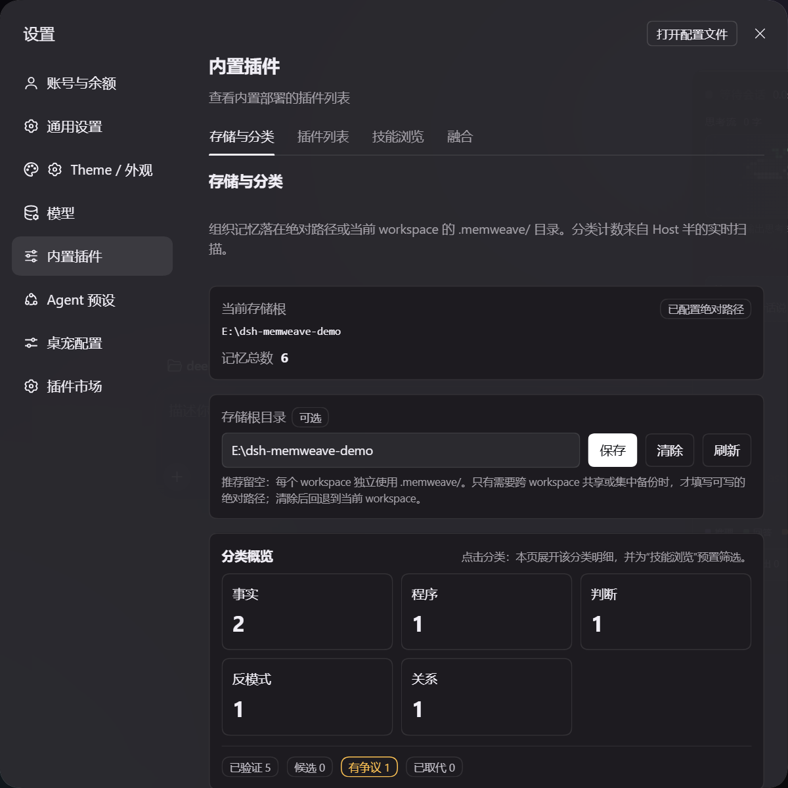
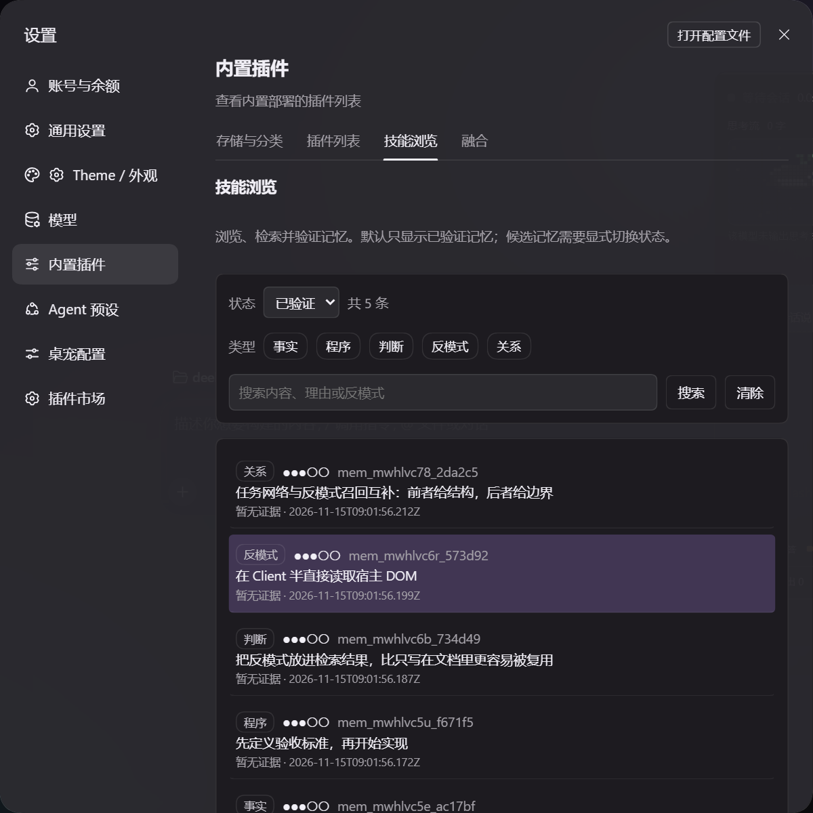
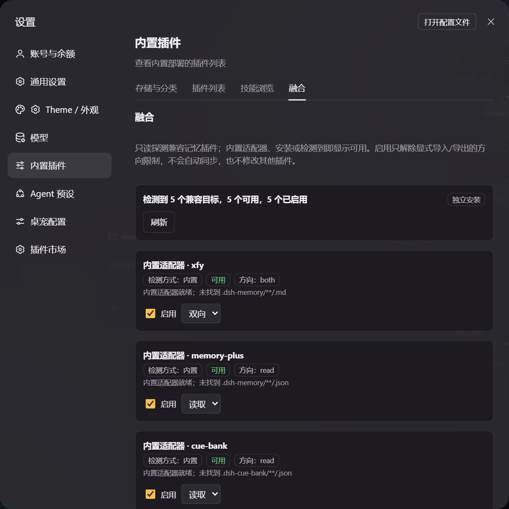
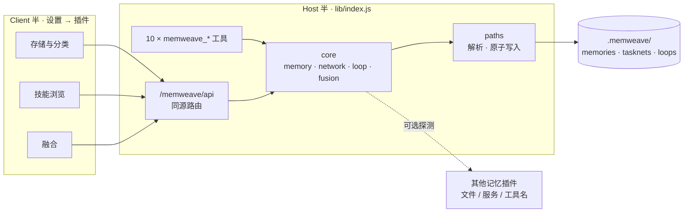
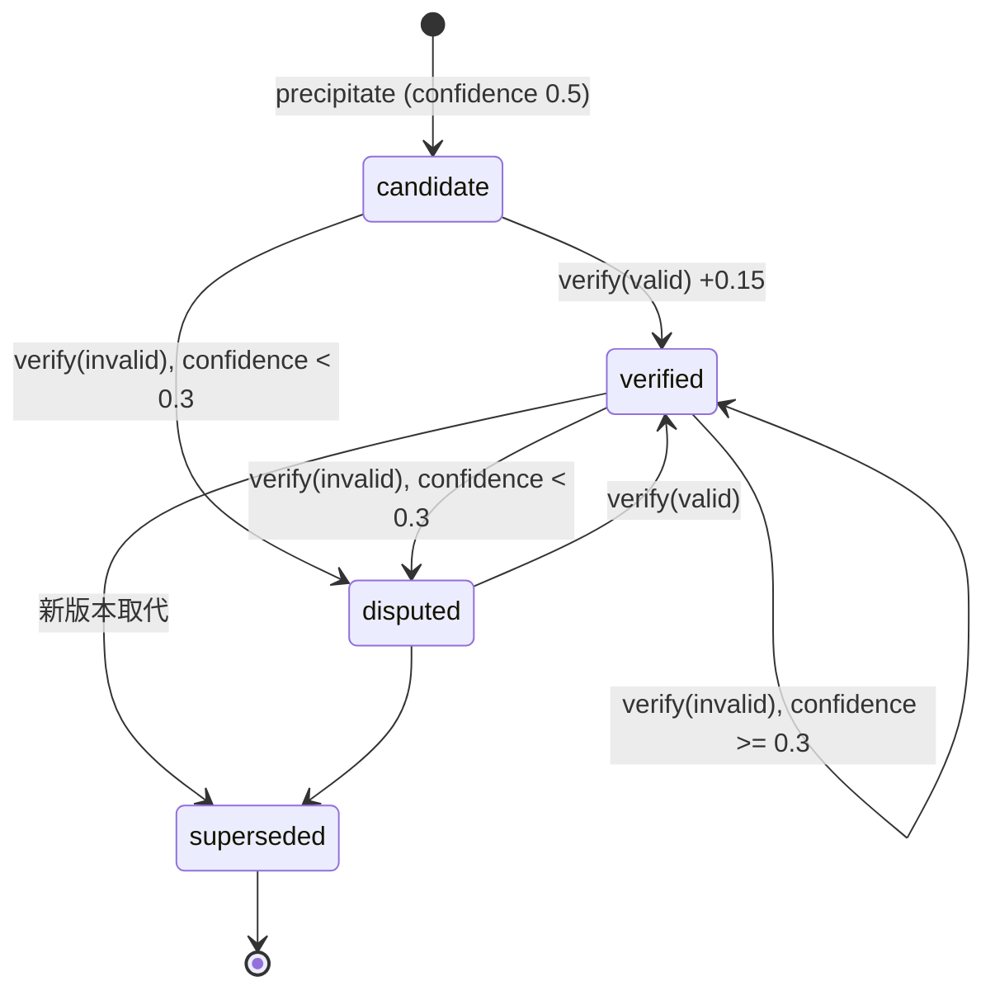

<p align="center">
  
</p>

<h1 align="center">织忆 <sub>dsh-memweave</sub></h1>

<p align="center">
  <b>把任务、判断、反模式与可衡量 Loop 织成组织记忆。</b><br/>
  一个可验证、可检索、可融合的 DeepSeek Harness 插件。
</p>

<p align="center">
  
  
  
  
  
</p>

<p align="center">
  <a href="#quick-start">快速开始</a> ·
  <a href="./docs/USAGE.md">使用指南</a> ·
  <a href="#tools">工具</a> ·
  <a href="#settings">设置页</a> ·
  <a href="#architecture">架构</a> ·
  <a href="#screenshots">界面预览</a> ·
  <a href="#fusion">融合</a> ·
  <a href="./DESIGN.md">设计文档</a> ·
  <a href="./CHANGELOG.md">更新日志</a> ·
  <a href="./README.en.md">English</a>
</p>

<details>
<summary>目录</summary>

- [为什么是“织忆”](#why)
- [亮点](#highlights)
- [界面预览](#screenshots)
- [架构](#architecture)
- [快速开始](#quick-start)
- [工具](#tools)
- [设置页](#settings)
- [配置](#config)
- [存储与记忆生命周期](#storage)
- [融合](#fusion)
- [可选聚合层](#aggregate)
- [安全与隐私](#security)
- [开发与测试](#development)
- [故障排查](#troubleshooting)
- [路线图](#roadmap)
- [设计文档](#design)
- [使用指南](./docs/USAGE.md)
- [插件市场巡检](./docs/MARKET-DISCOVERY.md)
- [贡献](#contributing)
- [License](#license)

</details>

---

<a id="why"></a>
## 为什么是“织忆”

大多数“记忆”只是把聊天记录存起来。织忆关心的是另一件事：**一条经验凭什么值得被下一次任务信任？**

它把组织进化的三个原则直接写进工具契约：

| 原则 | 在织忆里的硬约束 |
|---|---|
| **以任务为中心，而不是以岗位为中心** | 任务网络是基本单元；节点只标 `human / agent / hybrid`，不预设岗位 |
| **沉淀隐性知识，而不是操作手册** | `judgment` 必须说明“为什么有效”；`anti_pattern` 必须说明“什么情况下无效” |
| **流程闭环，而不是重复劳动** | Loop 必须有指标、目标、单位、节奏；三轮起才给趋势 |

两条贯穿始终的约束：

- **反模式优先**：检索结果里没有反模式、但存在相关反模式时，强制召回最高分的一条。
- **记忆需验证**：新记忆是 `candidate`，不进入默认检索池；只有 `memweave_memory_verify(valid)` 后才进入 `verified`。

---

<a id="highlights"></a>
## 亮点

| 图标 | 能力 | 说明 |
|---|---|---|
| 🧠 | **可验证的记忆生命周期** | `candidate → verified / disputed / superseded`，置信度随验证结果变化 |
| 🪤 | **反模式强制召回** | 不让“踩过的坑”淹没在成功经验里 |
| 📈 | **可衡量 Loop** | 没有指标、目标、单位、节奏，就不能创建循环 |
| 🕸️ | **任务网络** | 目标拆成带依赖的任务节点，并自动注入相关反模式警告 |
| 🖥️ | **三个设置标签页** | 存储与分类、技能浏览、融合，全部读写同一份 Host 数据 |
| 🔌 | **只读融合层** | 兼容其他记忆插件；五个目标都带内置适配器，不改配置、不劫持工具、不自动同步 |
| 🔒 | **本地原子存储** | 独占临时文件 + `rename`；单文件写入原子 |
| 📦 | **零第三方运行时依赖** | Host 只依赖 DSH SDK 与 Node 内置模块；Client 只用宿主 React |

---

<a id="screenshots"></a>
## 界面预览

以下截图来自真实运行的 DSH 0.2.x Web UI；`插件列表` 是设置外壳自带的标签页，织忆贡献其余三个。示例数据仅用于演示。完整操作步骤与更多截图见 [使用指南](./docs/USAGE.md)。

<details open>
<summary><b>存储与分类</b>：绝对路径、五类计数与状态分布</summary>



</details>

<details>
<summary><b>技能浏览</b>：状态/类型/关键词筛选，列表与验证入口</summary>



</details>

<details>
<summary><b>融合</b>：5 个已知兼容插件的只读探测与方向开关（截图为前 3 项，向下滚动可查看全部 5 项）</summary>



</details>

---

<a id="architecture"></a>
## 架构



| 半边 | 职责 | 不做什么 |
|---|---|---|
| **Host** | 10 个工具、记忆/任务/Loop 核心、原子存储、同源设置 API、兼容探测 | 不渲染 UI、不打包、不混淆 |
| **Client** | 三个设置标签页、筛选/详情/验证/融合开关、主题 token | 不直接读写文件、不操作宿主 DOM |

Host 的必需依赖只有 `tools`；`webServer`、`configEditor` 和所有兼容插件都是**可选探测**。缺失时工具仍可用，设置页会显示明确的降级原因。

---

<a id="quick-start"></a>
## 快速开始

### 环境要求

- DeepSeek Harness Desktop **0.2.x**（desktop profile）
- 一个可写的 workspace
- 无需从 npm 安装第三方运行时依赖

### 1. 安装

在 DSH 的 `plugin_manager` 中调用：

```json
{
  "action": "install_bundle",
  "target": "<本仓库的绝对路径>"
}
```

安装完成后，`dsh-memweave` 会成为当前 profile 的一个 bundle。默认 patch 只插入自身一行：

```yaml
- insert:
    - id: memweave
      name: dsh-memweave
```

### 2. 验证

| 检查项 | 预期 |
|---|---|
| **设置 → 插件** | 出现 `存储与分类`、`技能浏览`、`融合` 三个标签页 |
| 模型工具 | 可见 10 个 `memweave_*` 工具 |
| 默认存储 | 当前会话 workspace 下的 `.memweave/` |

> DSH 的普通 Config 字段变更会重启插件。保存存储路径后若页面短暂提示“读取失败”，等一秒点“重试”即可；UI 已内置一次重试。

### 3. 跑一次完整闭环

```text
# 1. 拆任务
memweave_decompose("把插件做到可安装")

# 2. 定义可衡量 Loop
memweave_loop_start(
  loopName="发布周期",
  metricName="交付时长",
  metricTarget=3,
  metricUnit="天",
  cadence="weekly"
)

# 3. 记录一轮
memweave_loop_record(loopId, 5)

# 4. 复盘后沉淀判断
memweave_precipitate(
  type="judgment",
  content="先注册工具再写 UI，能更早发现契约错误",
  rationale="defineTool 在注册阶段就会校验 schema"
)

# 5. 下一次任务中检索，并验证它是否真的有用
memweave_memory_find("插件 schema 注册")
memweave_memory_verify(memoryId, "valid", "在任务 42 复现")
```

三轮之后，`memweave_loop_record` 才会返回 `improving / worsening / stable`；在此之前是 `insufficient_data`。

---

<a id="tools"></a>
## 工具

共 10 个模型工具。所有工具只返回 canonical JSON，`output.render` 恰好输出一个文本块。

| 工具 | 类别 | 何时用 | 关键约束 |
|---|---|---|---|
| `memweave_decompose` | 任务网络 | 开始新任务、拆解模糊目标 | 确定性 6 节点骨架；节点带 `dependsOn` 与 `executor` |
| `memweave_precipitate` | 组织记忆 | 任务完成、发现有效判断、踩坑 | `anti_pattern` 必须有 `antiPatterns`；`judgment` 必须有 `rationale` |
| `memweave_memory_find` | 组织记忆 | 拆任务、设计 Loop、引用旧判断 | 默认只搜 `verified`；反模式强制召回 |
| `memweave_memory_verify` | 组织记忆 | 用过一条记忆、知道它是否有效 | `valid` +0.15；`invalid` −0.25，低于 0.3 转 `disputed` |
| `memweave_memory_list` | 组织记忆 | 浏览、分类计数、分页 | `summaryByType` 始终五个键 |
| `memweave_loop_start` | 可衡量 Loop | 定义可迭代的流程 | 指标名/目标/单位/节奏必填 |
| `memweave_loop_record` | 可衡量 Loop | 每轮迭代结束 | 三轮起计算趋势；v1 约定越小越好 |
| `memweave_fusion_status` | 融合 | 问兼容性、导入导出前 | 只读探测；缺失即降级 |
| `memweave_import` | 融合 | 明确要求从其他记忆插件导入 | `dryRun` 不写盘；正式导入写 `candidate`、`confidence=0.4` |
| `memweave_export` | 融合 | 明确要求导出为兼容格式 | 只写 `.memweave-exports/`，不写对方目录 |

### 记忆类型

| 类型 | 回答的问题 | 必填 |
|---|---|---|
| `fact` | 发生了什么？ | `content` |
| `procedure` | 怎么做？ | `content` |
| `judgment` | 为什么这样做有效？ | `content` + `rationale` |
| `anti_pattern` | 什么情况下会失效？ | `content` + `antiPatterns` |
| `relation` | 两条记忆如何关联？ | `content` |

---

<a id="settings"></a>
## 设置页

打开 **设置 → 插件**：

| 标签页 | 你能做什么 |
|---|---|
| **存储与分类** | 查看存储根、来源与目录状态；保存/清除绝对路径；查看五类计数与四种状态；点击分类下钻 |
| **技能浏览** | 按状态/类型/关键词筛选；分页浏览；查看详情；执行“有效 / 无效 / 未定”验证 |
| **融合** | 查看 5 个已知兼容插件的检测方式与可用性；开关融合；选择读/写/双向；查看聚合包状态 |

验证按钮与 `memweave_memory_verify` 共用同一个 Host core，不存在两套写入逻辑。

> 分类点击会**在本页展开该分类明细**，并把筛选预置给“技能浏览”；由于设置外壳没有向注册者暴露“切换标签页”的 API，织忆不读取或操作宿主 DOM。

---

<a id="config"></a>
## 配置

插件通过 DSH 原生 `Config` 暴露两个字段：

| 字段 | 类型 | 默认 | 说明 |
|---|---|---|---|
| `storageRoot` | string | `""` | 记忆存储根目录的绝对路径；留空使用当前 workspace 的 `.memweave/` |
| `fusion` | object | `{}` | `{ "<pluginKey>": { enabled: boolean, direction: "read" \| "write" \| "both" } }` |

规则：

- `storageRoot` **必须是绝对路径**；相对路径会被 Host 以 `INVALID_ARGUMENT` 拒绝。
- 清除 `storageRoot` 后回退到 workspace 的 `.memweave/`。
- 修改普通 Config 字段会触发插件重启，这是 DSH 的生命周期规则，不是插件自行重启。
- 设置页通过 `configEditor` 写回 profile patch，不直接改 profile 文件。

---

<a id="storage"></a>
## 存储与记忆生命周期

### 目录

```text
<root>/
├── memories/<memoryId>.json
├── tasknets/<netId>.json
└── loops/<loopId>.json
```

### 生命周期



- `candidate`：新写入，默认检索池不可见。
- `verified`：经过正向验证，进入默认检索池。
- `disputed`：验证无效且置信度低于 0.3；可浏览，但不进入检索池。
- `superseded`：被新版本取代；保留归档，不参与检索，拒绝再次验证。

> v1 没有自动 supersede 工具；该状态由未来版本或手工维护。`precipitate` 只返回重叠提示，不会擅自替代旧记忆。

### 检索打分

```text
score     = tfidf(query, memory) × trust × type_boost
trust     = confidence × (1 + 0.6 × (freshness − 0.5))
freshness = clamp(1 − ageDays(lastVerifiedAt ?? createdAt) / 90, 0, 1)

type_boost = anti_pattern 1.3 / judgment 1.1 / procedure 1.0 / fact 0.9 / relation 0.8
```

- 词法：拉丁/数字按词，中文按二元组（bigram）。
- 默认语料：`verified`；`includeCandidates=true` 时追加 `candidate`。
- 反模式强制召回：Top N 没有反模式、但存在相关反模式时，用最高分反模式替换最低分结果。

### 原子写入

```text
tmp = <targetDir>/<targetName>.tmp.<12 hex>
open(tmp, 'wx', 0o600) → write → close → rename(tmp, target)
失败：best-effort unlink(tmp)
```

- 单文件写入原子；跨文件操作不是事务。
- 超过 1 小时的孤儿 `.tmp.*` 由 `memweave_memory_list` 顺带清理。
- v1 不 fsync。

---

<a id="fusion"></a>
## 融合

织忆不 import 其他插件的运行时值，不修改其他插件的配置，不劫持其他插件的工具。融合只通过以下公开机制发生：

1. `ctx.get(serviceName)` 可选服务探测；
2. 工具名探测；
3. workspace 下公开记忆文件的只读扫描；
4. 当前 profile 的安装态与内置适配器。

### 兼容矩阵

| 插件 | 检测方式 | 文件/格式 | 默认方向 |
|---|---|---|---|
| `dsh-memory-xfy` | 文件（内置） | `.dsh-memory/**/*.md` | 读 |
| `dsh-memory-plus` | 文件（内置） | `.dsh-memory/**/*.json` | 读 |
| `dsh-cue-bank` | 文件（内置） | `.dsh-cue-bank/**/*.json` | 读 |
| `dsh-task-memory` | 文件（内置；外部工具可选） | `.dsh-task-memory/**/*.md` | 读 |
| `dsh-graphmemory` | 文件（内置） | `.dsh-graphmemory/**/*.json` | 读 |

### 显式导入 / 导出

```text
memweave_fusion_status()

# 只预览，不写盘
memweave_import(pluginKey="dsh-memory-xfy", dryRun=true)

# 正式导入：candidate、confidence=0.4
memweave_import(pluginKey="dsh-memory-xfy")

# 只写 workspace/.memweave-exports/
memweave_export(pluginKey="dsh-memory-xfy", statusFilter="verified")
```

导入的 `anti_pattern` 如果没有反模式说明，会被降级为 `fact`，避免把违反契约的数据写进库。

---

<a id="aggregate"></a>
## 可选聚合层

DSH 0.2.x 的 Loader patch **没有 `optional: true` 行语义**：缺失包的行会变成 failed fiber。因此织忆不把兼容插件直接塞进默认 patch，而是提供一个**加法层**：

```powershell
# 1) 先安装 dsh-memweave（独立 bundle）
# 2) 生成只包含本机已安装兼容包的 patch
node scripts/prepare-aggregate.mjs --profile <profile-dir>

# 3) 把 aggregate/ 作为第二个 bundle 安装
#    plugin_manager -> install_bundle -> target = <repo>/aggregate
```

- `patches/aggregate.yaml` 是声明式单一事实来源。
- `scripts/prepare-aggregate.mjs` 检查本机安装情况，只写入可用的 optional 行。
- **不会重复插入 `dsh-memweave`**（避免 Loader 重复 entry id），聚合是独立安装之上的加法层。
- 安装聚合后，`memweave_fusion_status` 通过 `memweaveAggregate` 服务报告 `aggregateBundle: true`。

---

<a id="security"></a>
## 安全与隐私

- **同源设置 API**：`/memweave/api` 只接受 loopback 或显式 trusted host；拒绝跨站 `sec-fetch-site` 与异源 `Origin`。
- **本地数据**：记忆、任务网络、Loop 全部写在用户指定的本地目录；不联网、不上传。
- **路径校验**：`storageRoot` 必须是绝对路径；id 只允许安全字符，防止路径穿越。
- **导入边界**：只读 workspace 下公开的记忆文件；不写其他插件目录。
- **导出边界**：只写 workspace 的 `.memweave-exports/`，由用户自行搬运。
- **无凭据存储**：插件不保存 API key、token 或其他凭据。

---

<a id="development"></a>
## 开发与测试

### 结构

```text
dsh-memweave/
├── lib/                 # Host 半：10 个工具、core、存储、API、融合
├── client/              # Client 半：classic script，注册三个设置标签页
├── patches/             # 默认 bundle patch + 声明式聚合清单
├── aggregate/           # 可选聚合包（marker + 生成的 patch）
├── scripts/             # prepare-aggregate.mjs
├── locale/              # zh/en 显示元数据
├── test/                # 40 个测试：Host、API、paths、client、aggregate
├── DESIGN.md            # 完整设计文档与 ADR
└── README.md
```

### 命令

```powershell
npm test        # node --test "test/*.test.mjs"
npm run check   # 语法检查 Host/Client 入口
node scripts/prepare-aggregate.mjs --profile <profile-dir>
```

### 工程纪律

- Host 半明文可读，不打包、不混淆。
- Host 不使用第三方运行时依赖；Client 不引入外部 UI 库。
- Client 只使用宿主主题 token，不读取或操作宿主 DOM。
- 工具的 `description` 以 `Use when …` 开头；每个 `execute` 观察 `exec.signal`。
- 可预期失败抛带 code 的 `HarnessError`；不返回 `{ ok:false }`。

本地测试需要能解析 `@deepseek-ai/dsh-tools`、`@deepseek-ai/dsh-llm`、`@deepseek-ai/schemastery`；本机由 DSH profile 的共享 SDK 目录提供，仓库不提交 `node_modules`。

---

<a id="troubleshooting"></a>
## 故障排查

| 现象 | 可能原因 | 处理 |
|---|---|---|
| 设置里看不到三个标签页 | 插件未启用 / 页面未刷新 | 在插件管理中确认 `dsh-memweave` 已启用；刷新页面 |
| 模型看不到 `memweave_*` 工具 | 插件 fiber 未激活 | 查看插件清单状态；禁用再启用一次 |
| 保存存储路径后报读取失败 | Config 变更触发重启的竞态 | 等 1 秒点“重试”；UI 已自动重试一次 |
| 提示 `storageRoot 必须是绝对路径` | 填了相对路径 | 改为绝对路径，或清空使用 `.memweave/` |
| 融合标签页显示“不可用” | 目标不是内置适配器，且没有对应文件/工具/安装态 | 确认目录与格式；文件探测只读公开区域 |
| 聚合安装后没有 marker | 先装了聚合、未装独立版 | 先安装 `dsh-memweave`，再安装 `aggregate/` |
| 导入 0 条、跳过 N 条 | 内容重复或文件不可读 | 先 `dryRun` 看示例；检查文件编码与格式 |

---

<a id="roadmap"></a>
## 路线图

| 版本 | 状态 | 内容 |
|---|---|---|
| **v1.0** | ✅ 已发布 | 10 个工具、三个设置页、融合层、聚合层、40 个测试 |
| v1.1 | 计划 | 任务网络更新工具；`superseded` 工作流；向量检索（保留可解释排序） |
| v1.2 | 计划 | 更多融合适配器；导出格式扩展；截图与演示素材 |
| 未来 | 探索 | 团队级共享存储、记忆合并建议、Loop 与任务完成自动关联 |

未发布项不会以“已支持”的口吻出现在文档里。

---

<a id="design"></a>
## 设计文档

更完整的契约、状态机、评分算法、平台修正与 ADR 在 [DESIGN.md](./DESIGN.md)：

- 为什么 `ctx.settings.register` 不存在，以及 `Config + configEditor` 的等价实现；
- 为什么 Client 不能直接调用 Host 工具，以及同源 API 的信任围栏；
- `dsh.client` 的真实加载机制；
- 聚合层为什么不是 `optional: true` 行；
- `memory_verify` / `loop_record` 为什么在 schema 上补了字段。

---

<a id="contributing"></a>
## 贡献

问题与建议：<https://github.com/lw24-1936/dsh-memweave/issues>

欢迎 Issue / PR，但请先确认：

1. `npm test` 全绿，新增行为有对应测试；
2. 不引入第三方 Host 运行时依赖或外部 Client UI 库；
3. 工具 schema 的显式 object 节点声明 `additionalProperties: false`；
4. 不修改其他插件的配置、运行时或私有目录。

---

## License

[MIT](./LICENSE) © 2026 lw24-1936

<p align="center"><sub>织忆 / Memweave · built for DeepSeek Harness</sub></p>
