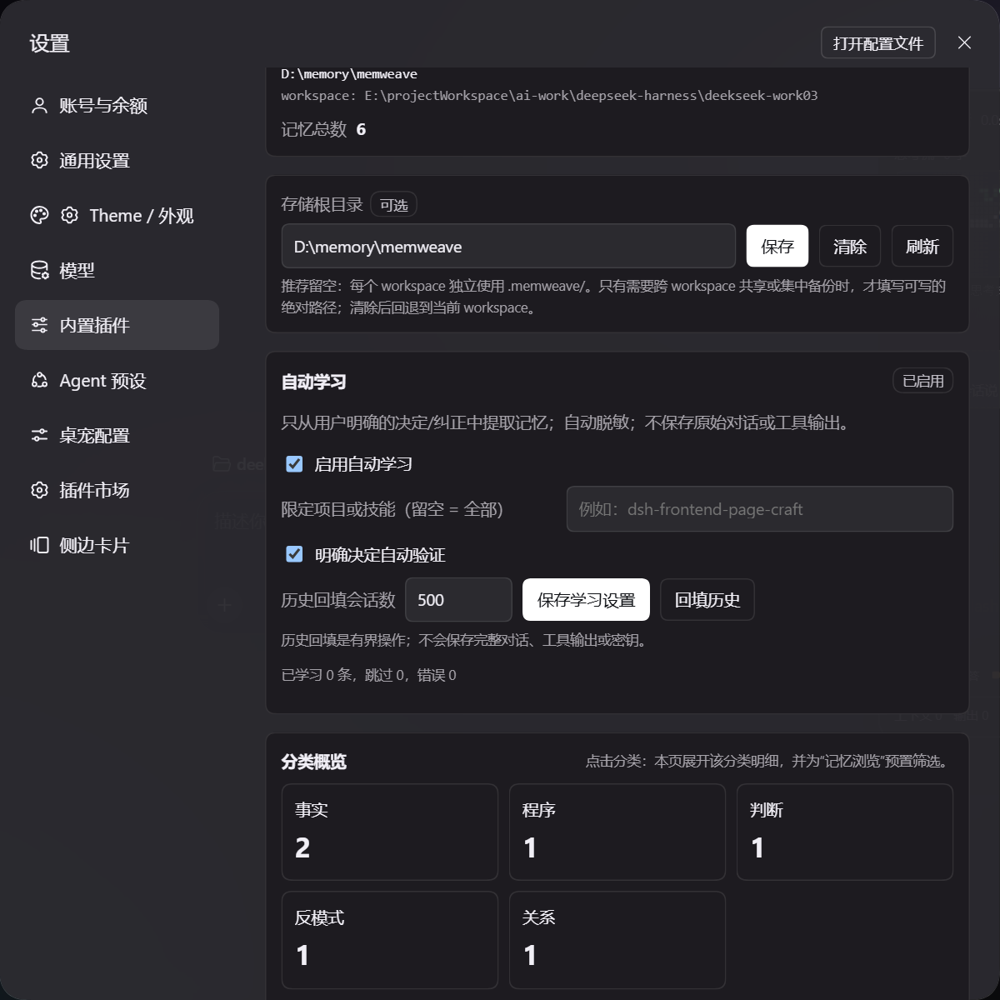

# 自动学习

> 默认关闭。开启后只提取**用户明确表达的决定/纠正**，自动脱敏；不保存原始对话、工具输出或助手推理。

## 1. 为什么默认关闭

Memweave 的核心是“可验证的记忆”，不是无差别聊天归档。全量保存所有会话会带来：

- 密钥、token、命令输出等敏感内容；
- 大量重复、寒暄和工具日志；
- 自动验证错误摘要后污染默认检索；
- 不同项目、不同技能的上下文混在一起。

因此自动学习是**显式开启的候选提取器**，不是全量记录器。

## 2. 能学习什么

- 只从 `user/message` 事件提取包含以下**长期信号**的句子：

- 明确决定：`决定`、`采用`、`就按`、`以后都`、`必须`、`记住`；
- 明确纠正：`不要`、`禁止`、`不能`、`改成`、`正确做法`、`注意`；
- 带原因/边界的流程性要求：`先…再…`、`每次`、`统一`。

不处理：

- 助手回复与推理；
- 工具调用参数和结果；
- 问题句；
- 原始 Markdown、日志、代码块。

自动学习写入的是压缩后的 `judgment` / `procedure` 记忆，不是对话原文。

## 3. 脱敏

以下内容会替换为 `[REDACTED]`：

- PEM 私钥；
- `sk-*`、`ghp_*`、`github_pat_*`、AWS access key；
- Bearer token；
- `password=`、`token=`、`secret=`、`api_key=` 等键值。

脱敏后没有有效内容的句子会被跳过。

## 4. 候选与自动验证

- 含 `必须`、`不要`、`禁止`、`决定`、`记住` 等强信号的用户表达：实时会话可自动验证；
- 历史回填统一写为 `candidate`，不自动验证；先审核再提升；
- 含 `可能`、`建议`、`如果` 等不确定词：只写 `candidate`；
- 所有自动记忆都在 `rationale` 中标注来源会话、项目和时间；
- 自动验证只针对**用户明确说的话**，不针对模型推断。

自动学习不会修改已有记忆，也不会自动删除。

## 5. 实时与历史

- **实时**：监听当前 Host 的 `session/event`，只处理新用户消息；
- **历史**：设置页的“回填历史”按钮，使用 `sessionQuery` 读取最近 N 个会话；
- 历史回填是有界操作，默认 50，最多 500；写入候选，不自动验证；
- 回填只读取 `user/message`，不保存原始事件。

## 6. 范围控制

设置项：

```yaml
autoLearn:
  enabled: true
  scope: dsh-frontend-page-craft
  autoVerify: true
  historyLimit: 50
```

- `scope` 为空：所有会话；
- `scope` 填项目路径片段或技能名：只学习 cwd 或消息文本包含该字符串的会话；
- 例如 `dsh-frontend-page-craft` 只学习提到该技能/项目的内容。

## 7. 设置页操作



1. 打开“存储与分类”；
2. 在“自动学习”卡片勾选“启用自动学习”；
3. 可选填写“限定项目或技能”；
4. 选择“明确决定自动验证”；
5. 保存学习设置；
6. 需要历史时，设置“历史回填会话数”并点“回填历史”。

状态行会显示已学习、跳过和错误计数。

## 8. 局限

- 自动学习是**启发式提取**，可能漏掉含蓄的决定，也可能把一句强语气误判为决定；
- 不自动把记忆注入每次对话；Agent 仍通过 `memweave_memory_find` 检索；
- 历史回填最多 500 个会话/次，不是无限归档；
- 自动验证的记忆可以在“记忆浏览”里改为 `disputed` 或删除；
- 不保存完整对话/工具输出，所以不能当作审计日志。
