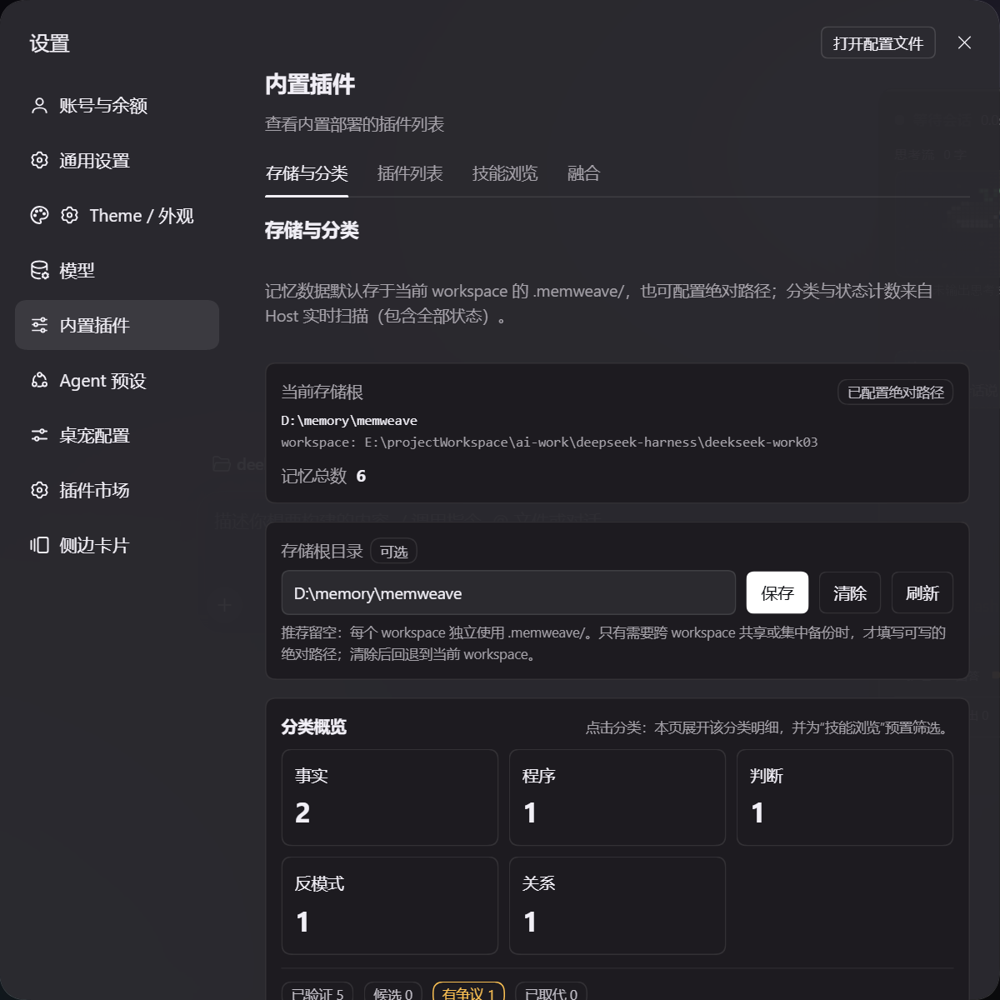
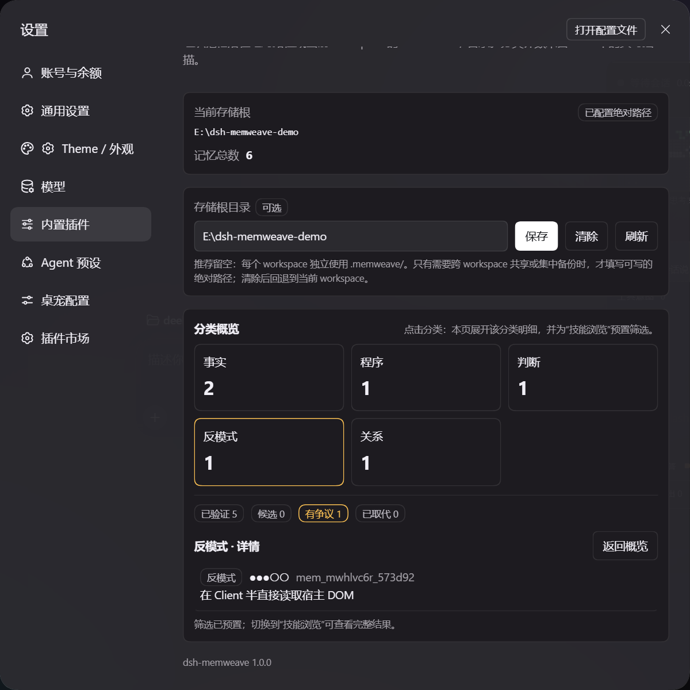
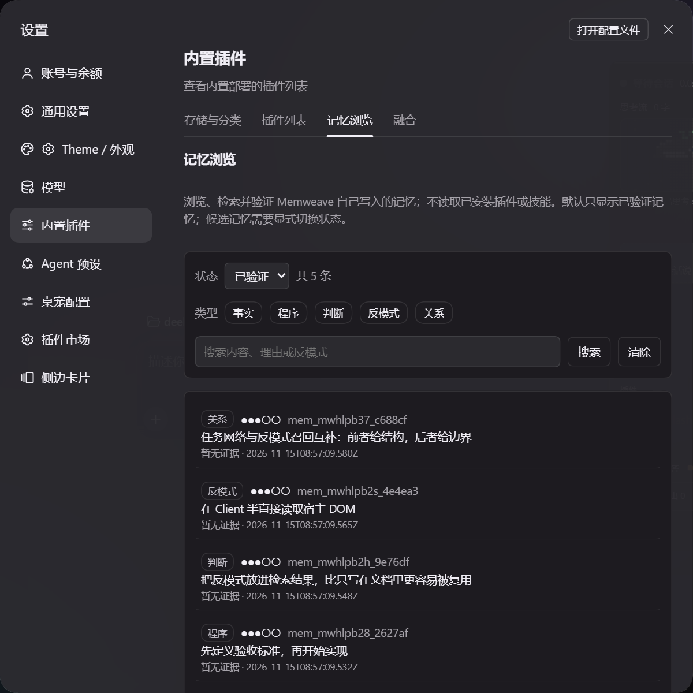
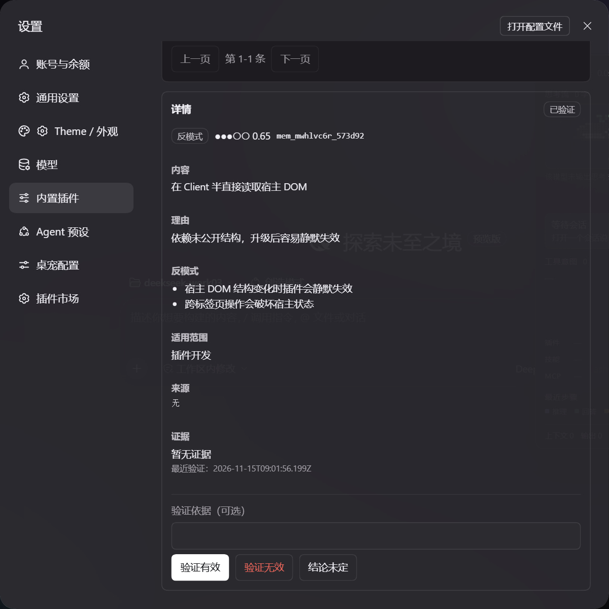
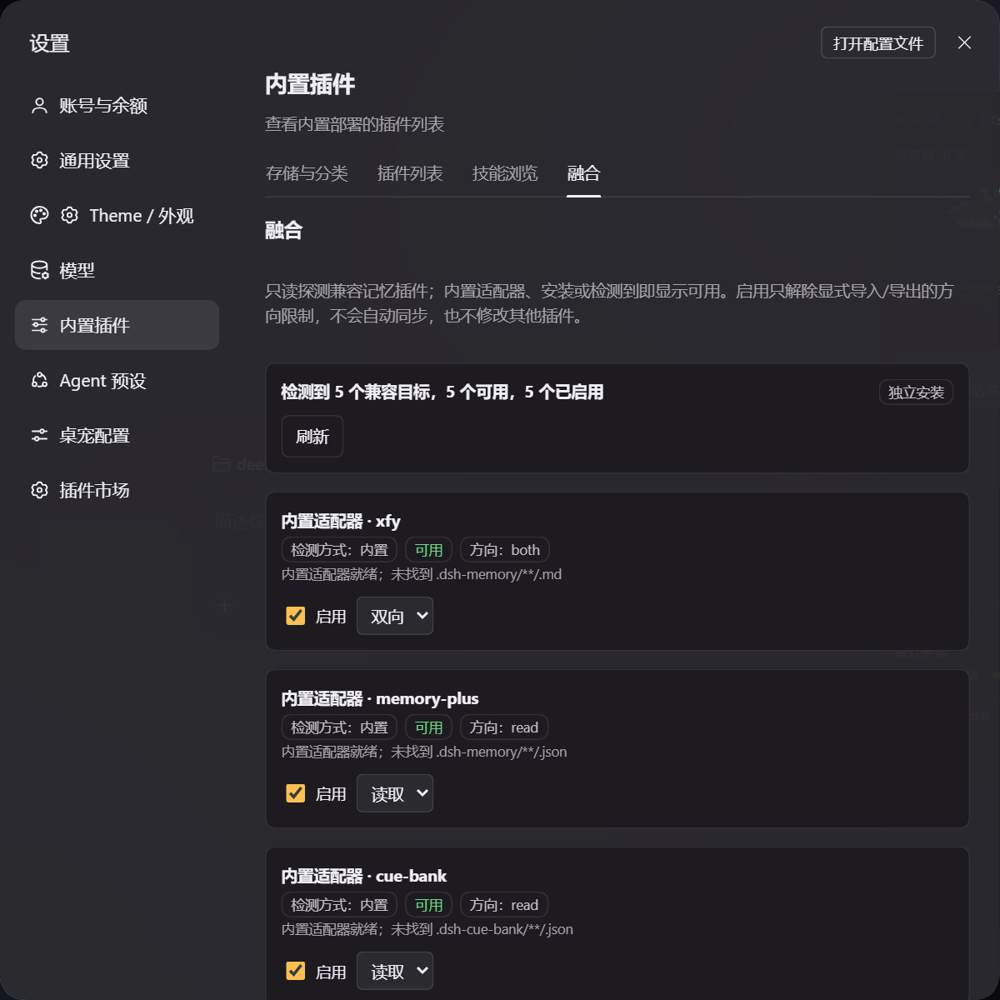

# 织忆使用指南

> 适用版本：**dsh-memweave 1.0.0**，DeepSeek Harness **0.2.x**
>
> 本文截图来自真实运行的 DSH Web UI；其中的记忆、路径和插件状态是**临时示例数据**，用于说明操作，截图后已清理。你的界面以实际数据为准。

织忆在 **设置 → 内置插件** 中提供三个标签页：

| 标签页 | 主要用途 | 数据操作 |
|---|---|---|
| **存储与分类** | 查看/切换记忆库位置，浏览五类计数与状态分布 | 配置 `storageRoot`，只影响之后读写的目录 |
| **技能浏览** | 筛选、搜索、查看详情、验证记忆 | 读取与验证记忆 |
| **融合** | 探测其他记忆插件，启用/关闭融合方向 | 写插件配置；不自动读写其他插件 |

> 设置外壳自带的 `插件列表` 标签页不属于织忆；织忆贡献的是另外三个。

---

## 1. 安装与打开

### 1.1 安装

在 DSH 的 `plugin_manager` 中安装本仓库的绝对路径：

```json
{
  "action": "install_bundle",
  "target": "<dsh-memweave 的绝对路径>"
}
```

安装成功后，模型侧会出现 10 个 `memweave_*` 工具，设置页会出现织忆的三个标签页。更完整的安装/聚合说明见 [README](../README.md)。

### 1.2 打开

1. 点击左下角**账号头像**。
2. 选择 **设置**。
3. 在左侧选择 **内置插件**。
4. 选择 **存储与分类**、**技能浏览** 或 **融合**。

也可以使用设置快捷键 **Ctrl + Alt + ,**（Windows/Linux）。

### 1.3 首次打开时看到什么

- 三个标签页默认是空的或显示 0 条记忆，这是正常的。
- 默认存储位置是**当前 workspace** 下的 `.memweave/`，不需要你填写任何路径。
- 如果你还没有产生记忆，先使用 Agent 工具沉淀一条，或跳到 [第 3 节](#3-技能浏览) 了解验证流程。

---

## 2. 存储与分类

### 2.1 页面概览



页面从上到下分为四块：

1. **当前存储根**：当前实际生效的目录、来源标记、记忆总数。
2. **存储根目录（可选）**：配置自定义绝对路径的输入区。
3. **分类概览**：事实 / 程序 / 判断 / 反模式 / 关系五类计数。
4. **状态分布**：已验证 / 候选 / 有争议 / 已取代。

“来源”可能是：

| 来源标记 | 含义 |
|---|---|
| 已配置绝对路径 | 你在输入框保存了自定义 `storageRoot` |
| 最近会话 workspace | 当前没有自定义路径，正在使用最近会话的 workspace |
| 会话 workspace | 当前请求带有明确的会话 workspace |
| Host 启动目录 | 没有会话信息时的兜底目录，通常不建议依赖 |

### 2.2 存储根目录是什么

它就是**记忆文件存放的文件夹**。目录结构固定为：

```text
<存储根>/
├── memories/<memoryId>.json    # 记忆条目
├── tasknets/<netId>.json       # 任务网络
└── loops/<loopId>.json         # 可衡量 Loop
```

**它不是“导入目录”，也不是“缓存目录”**。织忆的读写都发生在这里；备份就是复制整个目录。

### 2.3 可以不配置吗？

**可以，而且推荐留空。**

| 选择 | 实际位置 | 适合场景 |
|---|---|---|
| **留空（推荐）** | `<当前 workspace>/.memweave/` | 日常使用；不同项目各自独立 |
| 填写绝对路径 | 你指定的目录，例如 `D:\memory\memweave` | 跨 workspace 共享、集中备份 |
| 填写相对路径 | 不允许，Host 会返回 `INVALID_ARGUMENT` | —— |

留空的好处：

- 每个 workspace 的记忆互不干扰；
- 不需要记路径，也不会因为盘符变化失效；
- 迁移 workspace 时记忆跟着项目走。

只有这些情况才需要自定义：

- 多个项目要共用一套组织记忆；
- 想把记忆统一放到备份盘；
- 需要让不同的 DSH 会话读取同一份库。

### 2.4 留空使用（推荐操作）

1. 看“当前存储根”是否显示 `.memweave/` 和“最近会话 workspace”。
2. 输入框保持为空。
3. 不需要点“保存”；需要强制刷新时点“刷新”。
4. 之后沉淀的记忆会自动写入当前 workspace 的 `.memweave/`。

如果你之前配置过路径：

1. 清空输入框，点“保存”（保存空值），或点“清除”。
2. Host 会重启插件，等待约 1 秒。
3. 点“刷新”，确认“来源”回到 workspace，且路径以 `.memweave` 结尾。

> “清除”恢复的是**默认位置**，不会删除自定义目录里的文件；旧数据只是暂时不再被读取。

### 2.5 配置自定义目录

> 只有确实需要共享/集中备份时才做。

1. 在输入框填入**可写的绝对路径**，例如 `D:\memory\memweave`。
2. 点白色黑字的 **保存** 按钮。
3. 普通 Config 变更会重启 Host 半；设置页可能短暂断开。
4. 等待 1–2 秒后点 **刷新**，确认：
   - “当前存储根”显示新路径；
   - 来源显示“已配置绝对路径”；
   - 目录下出现 `memories/`、`tasknets/`、`loops/`。
5. 如果页面提示读取失败，等一秒点“重试”或“刷新”。

注意事项：

- **不会自动迁移旧数据**。换到新根后，旧根里的记忆不会自动复制过来。
  需要迁移时，关闭 DSH 或停止插件写入，手动复制 `memories/`、`tasknets/`、`loops/` 三个子目录。
- 不支持 `~`、环境变量、相对路径；必须写完整绝对路径。
- 目录必须可写；权限不足会在页面/工具中报错。
- 共享目录意味着所有使用该根的 workspace 会看到同一份记忆，注意数据隔离。

### 2.6 分类概览与下钻

五个分类是：

| 分类 | 回答的问题 |
|---|---|
| 事实 | 发生了什么？ |
| 程序 | 怎么做？ |
| 判断 | 为什么这样做有效？ |
| 反模式 | 什么情况下会失效？ |
| 关系 | 两条记忆如何关联？ |

计数按**全部状态**统计，因此“候选”和“有争议”也会计入分类总数。

点击某个分类卡片：

1. 卡片高亮，页面下方展开该分类的 **已验证** 记忆明细；
2. 同时给“技能浏览”预置该类型的筛选；
3. 点“返回概览”收起明细。



注意：下钻列表只查 `verified`，所以如果某分类只有候选/有争议记忆，展开后可能是空的。完整数据请到“技能浏览”切换状态查看。

### 2.7 状态分布

| 状态 | 含义 | 默认检索 |
|---|---|---|
| 已验证 | 经过正向验证 | ✅ 可见 |
| 候选 | 新沉淀，尚未验证 | ❌ 需显式切换 |
| 有争议 | 验证无效且置信度低于 0.3 | ❌ 需显式切换 |
| 已取代 | 被新版本取代的归档 | ❌ 不参与检索 |

状态变化规则见 [3.5](#35-状态与置信度)。

### 2.8 刷新、错误与跳过

- **刷新**：重新扫描当前存储根；不会修改数据。
- **跳过文件**：记忆文件损坏或字段不合法时，列表会显示“跳过损坏文件 N”，单个坏文件不会让整个列表失败。
- **读取失败**：常见于自定义目录不可写、路径不存在、配置刚变更后的重启窗口；先刷新/重试，再检查目录权限。

---

## 3. 技能浏览

### 3.1 界面



界面从上到下：

1. **状态**下拉：默认“已验证”，可切换候选/有争议/已取代。
2. **类型**按钮：事实/程序/判断/反模式/关系，可多选。
3. **搜索框**：匹配内容、理由、反模式；回车或点“搜索”。
4. **列表**：每页 50 条，显示类型、置信度圆点、ID、内容摘要、证据状态、时间。
5. **详情面板**：点击列表条目后出现。
6. **分页**：上一页 / 第 x-y 条 / 下一页。

> “清除”只清空**搜索关键词**，不会清空状态或类型筛选。要取消类型，请再点一次已选中的类型按钮。

### 3.2 筛选与搜索

| 操作 | 步骤 |
|---|---|
| 按状态 | 状态下拉选择；默认只显示已验证 |
| 按类型 | 点击一个或多个类型按钮；再次点击取消 |
| 按关键词 | 输入内容/理由/反模式关键词，回车或点“搜索” |
| 重置搜索 | 点“清除” |
| 翻页 | 上一页/下一页；修改筛选会自动回到第一页 |
| 找候选记忆 | 状态切到“候选” |
| 找有争议记忆 | 状态切到“有争议” |

搜索是词法匹配（TF-IDF + 中文二元组），不是语义向量搜索；关键词越具体越好。

### 3.3 查看详情

点击列表条目，右侧（窄屏时在下方）显示详情：



详情字段：

| 字段 | 说明 |
|---|---|
| 类型/置信度/状态/ID | 例如 `反模式`、`●●●○○ 0.65`、`已验证` |
| 内容 | 经验本身 |
| 理由 | 为什么有效 |
| 反模式 | 什么情况下失效（反模式类型必有） |
| 适用范围 | taskTypes / conditions |
| 来源 | 任务引用 |
| 证据 | Loop 记录、任务完成等摘要 |
| 最近验证 | 最近一次验证时间 |
| 验证日志 | 历史验证记录（含备注） |

### 3.4 验证一条记忆

适用场景：你在新任务中实际用了这条记忆，知道它有效/无效/还说不准。

1. 在列表中点选目标记忆。
2. 在“验证依据（可选）”填写复现信息，例如“在任务 42 复现”。
3. 点击：
   - **验证有效**：置信度 `+0.15`，候选/有争议 → 已验证；
   - **验证无效**：置信度 `-0.25`，低于 0.3 → 有争议；
   - **结论未定**：状态和置信度不变，但记录最近验证时间与日志。
4. 等待写入完成；列表和状态计数会刷新。
5. 如果是“候选”记忆，验证后可能从当前列表消失，这是因为它变成了“已验证”；切换状态即可看到。

> 点击即写入，没有二次确认。请确认选中的是正确记忆；备注建议写清楚依据。

### 3.5 状态与置信度

```text
candidate ──verify(valid) +0.15──► verified
    │                                  │
    └──verify(invalid) -0.25──► disputed（confidence < 0.3）
                                       │
                                  verify(valid)
                                       ▼
                                   verified
```

| 当前状态 | 操作 | 结果 |
|---|---|---|
| 候选 | 有效 | 已验证；置信度 +0.15 |
| 候选 | 无效 | 若新置信度 < 0.3 → 有争议 |
| 已验证 | 无效 | 置信度 ≥ 0.3 仍为已验证；< 0.3 → 有争议 |
| 有争议 | 有效 | 已验证 |
| 已取代 | 任意 | 拒绝验证（`INVALID_ARGUMENT`） |

置信度圆点含义：`●●●○○ 0.65` 中的数字就是精确置信度；新记忆初始为 `0.50`。

---

## 4. 融合

### 4.1 融合是什么，不是什么

融合只做三件事：

1. 探测其他记忆插件是否存在（文件/服务/工具名）；
2. 允许你在**显式调用** `memweave_import` / `memweave_export` 时读写兼容格式；
3. 在设置页展示探测结果和开关。

它**不会**：

- 自动同步；
- 自动导入/导出；
- 修改其他插件的配置；
- 劫持其他插件的工具；
- 写入其他插件的私有目录。

### 4.2 状态卡


顶部汇总：

- `检测到 5 个兼容插件，0 个已启用`
- 聚合状态徽章：`独立安装` 或 `聚合包已启用`

每个插件卡片显示：

| 字段 | 说明 |
|---|---|
| 插件名 | 如 `内置适配器 · xfy` |
| 检测方式 | 文件 / 服务 / 工具 |
| 可用状态 | 可用（绿色）/ 不可用（黄色）；内置适配器也显示“可用” |
| 方向 | 读取 / 写入 / 双向 |
| 详情 | 找到了几个文件，或缺失原因 |
| 启用 | 开关 |
| 读取/写入/双向 | 方向选择 |

`刷新` 会重新探测，不修改配置。

### 4.2.1 如何让插件变为“可用”

“可用”与“启用”是两件事：

- **可用**：内置适配器就绪，或安装/探测到了外部插件的数据/工具；
- **启用**：你允许织忆在显式调用时按方向读写。

探测优先级：服务 → 已知工具名 → workspace 下的公开文件 → **已安装的包** → **内置适配器**。兼容包已经安装在当前 profile，或该目标带有内置适配器时，即使还没有产生数据，也会显示为可用；你仍需通过“启用”决定是否允许导入/导出。

其中四个文件桥接目标（`dsh-memory-plus`、`dsh-cue-bank`、`dsh-task-memory`、`dsh-graphmemory`）**自带内置适配器**：没有安装外部插件时显示“检测方式：内置”，不会变红。`dsh-memory-xfy` 也保留内置文件适配器作为兜底。内置适配器只代表格式桥接代码已就绪，**不代替外部插件的数据**；导入仍需要 workspace 中存在匹配文件。

因此，默认情况下**不需要安装任何外部插件**，五个目标都会显示可用；你只需要决定是否启用。只有在需要某插件的原生引擎/数据时，才安装真实插件。

#### 方式一：安装并启用真实插件（可选）

1. 用 `plugin_manager` 安装目标插件，例如 `dsh-memory-xfy`。
2. 确认它已启用，并且它注册的工具在当前 Agent 中可见。
3. 回到融合页点“刷新”。

如果该插件注册了织忆认识的工具名，会显示“检测方式：工具”；如果它在 workspace 写入了记忆文件，会显示“检测方式：文件”。

例如安装真实的 `dsh-memory-xfy` 后，融合页会显示“检测方式：工具”。注意：这表示工具探测成功，不等于它的原生存储文件已经被映射；`dsh-memory-xfy` 的实际数据默认在 `~/.dsh` 下，而织忆的文件桥接读取 workspace 的 `.dsh-memory/**/*.md`。要导入其原生数据，需要进一步适配它的存储布局。没有安装真实插件时，内置适配器仍然可用。

不要同时安装多个 memory 类插件：它们都可能注册 `memory_search` 等工具名，容易冲突。一次只装一个、验证通过后再考虑下一个。

#### 方式二：在 workspace 放置兼容记忆文件

这是最快的验证方式，也适用于插件已经产生数据、但织忆尚未识别的情况。

| 插件 | 放到当前 workspace 的路径 | 格式 |
|---|---|---|
| `dsh-memory-xfy` | `.dsh-memory/**/*.md` | Markdown |
| `dsh-memory-plus` | `.dsh-memory/**/*.json` | JSON |
| `dsh-cue-bank` | `.dsh-cue-bank/**/*.json` | JSON |
| `dsh-task-memory` | `.dsh-task-memory/**/*.md` | Markdown |
| `dsh-graphmemory` | `.dsh-graphmemory/**/*.json` | JSON |

示例（xfy）：

```powershell
$workspace = "E:\path\to\your\workspace"
New-Item -ItemType Directory -Force "$workspace\.dsh-memory" | Out-Null
@'
---
type: judgment
---
在安装前先跑契约测试，能更早发现 schema 错误。
'@ | Set-Content -Encoding utf8 "$workspace\.dsh-memory\demo.md"
```

示例（memory-plus）：

```json
{
  "memories": [
    { "type": "fact", "content": "记忆需要先验证再进入默认检索池" }
  ]
}
```

放好后回到融合页点 **刷新**，对应卡片应变成“可用”。

#### 仍然不可用时按顺序检查

1. 文件是否在**当前 workspace**，而不是别的项目目录；
2. 目录名是否精确匹配（`.dsh-memory`、`.dsh-cue-bank` 等）；
3. 扩展名是否匹配（`.md` 或 `.json`）；
4. 文件是否为空或不是有效格式（探测能看到，但导入会跳过）；
5. 嵌套是否过深，或是否位于 `node_modules`、`.git` 等被跳过的目录；
6. 插件是否真的启用，工具名是否在当前 Agent 中可见；
7. 点“刷新”重新探测。

> 聚合包只添加聚合标记，**不会替目标提供数据**；可用性由内置适配器、安装态、文件或工具探测决定。
>
> 自定义 `storageRoot` 不会影响融合探测：文件探测始终使用当前会话 workspace。

### 4.3 启用与方向



操作步骤：

1. 找到目标插件卡片。
2. 勾选 **启用**。
3. 在右侧下拉选择方向：
   - **读取**：允许从该插件导入；
   - **写入**：允许导出到该插件格式；
   - **双向**：两者都允许。
4. 等待配置写入（普通 Config 变更可能触发 Host 重启）。
5. 点“刷新”确认启用数变为 1，开关保持勾选。

重要：

- **启用不等于自动同步**。它只是解除显式导入/导出的方向限制；不会自动搬运数据。
- 融合开关只写织忆自己的配置，不修改对方插件。
- 关闭开关后，对应方向的工具调用会被拒绝，直到重新启用。

### 4.4 兼容矩阵

| 插件 | 检测方式 | 读取格式 | 导出格式 | 默认方向 |
|---|---|---|---|---|
| `dsh-memory-xfy` | 文件（内置） | `.dsh-memory/**/*.md` | Markdown | 读取 |
| `dsh-memory-plus` | 文件 | `.dsh-memory/**/*.json` | JSON | 读取 |
| `dsh-cue-bank` | 文件 | `.dsh-cue-bank/**/*.json` | JSON | 读取 |
| `dsh-task-memory` | 文件 / 工具 | `.dsh-task-memory/**/*.md` | Markdown | 读取 |
| `dsh-graphmemory` | 文件 | `.dsh-graphmemory/**/*.json` | JSON | 读取 |

说明：

- 文件探测只读 workspace 下公开区域，不进入其他插件私有运行时。
- 检测方式显示“工具”表示发现了已知工具名；不会自动调用它。
- 内置适配器让目标保持“可用”，但导入仍需要匹配文件；如果导入返回 0 条，检查 workspace 路径与格式。

### 4.5 导入（Agent 工具）

设置页**没有导入按钮**；导入必须由你明确要求 Agent 执行。

```text
# 1. 先预览，不写盘
memweave_import(pluginKey="dsh-memory-xfy", dryRun=true)

# 2. 确认后正式导入
memweave_import(pluginKey="dsh-memory-xfy")
```

正式导入的行为：

- 写入 `candidate`，置信度 `0.4`；
- 内容截断为 200 字符；
- 与已有记忆/本批次内容去重；
- 导入的 `anti_pattern` 如果没有反模式说明，会降级为 `fact`；
- 返回 `imported / skipped / samples`，可以看前几条样例。

### 4.6 导出（Agent 工具）

```text
memweave_export(pluginKey="dsh-memory-xfy", statusFilter="verified", limit=50)
```

- 只写 `<workspace>/.memweave-exports/`；
- 文件名：`<pluginKey>-<timestamp>.<md|json>`；
- 不会写对方插件目录，也不会修改对方数据；
- `statusFilter` 默认 `verified`，可选 candidate/disputed；
- `limit` 默认 50，最大 200。

### 4.7 聚合包状态

- **独立安装**：只安装了 `dsh-memweave`。
- **聚合包已启用**：还安装了可选的 `dsh-memweave-aggregate`，通过 `memweaveAggregate` 服务标记。

聚合只负责组合兼容行，不改变融合读写行为。安装方法见 [README 的可选聚合层](../README.md#aggregate)。

周期性巡检与新增适配的流程见 [融合适配巡检](./FUSION-MAINTENANCE.md)。

---

## 5. 常用场景

### 5.1 第一次使用：什么都不配置

1. 打开“存储与分类”，确认路径是 workspace 的 `.memweave/`。
2. 不做任何保存。
3. 让 Agent 用 `memweave_precipitate` 沉淀第一条记忆。
4. 回到“技能浏览”，状态切“候选”查看；验证后切“已验证”。

### 5.2 从其他记忆插件导入

1. 在“融合”确认目标插件“可用”。
2. 勾选启用，方向选“读取”。
3. 让 Agent 先 `dryRun=true` 预览。
4. 确认后正式导入。
5. 到“技能浏览”状态切“候选”查看新条目。
6. 逐条验证，有效的进入已验证池。

### 5.3 导出给其他插件

1. 融合中启用目标插件，方向选“写入”。
2. 让 Agent 调用 `memweave_export`。
3. 到 workspace 的 `.memweave-exports/` 取文件。
4. 由你自行放入对方插件目录；织忆不会代写。

### 5.4 验证一条反模式

1. “技能浏览”类型选“反模式”。
2. 点开目标条目，查看“反模式”字段。
3. 在真实任务中确认它是否发生。
4. 点“验证有效”或“验证无效”，填写依据。
5. 确认状态与置信度变化。

### 5.5 更换共享记忆库

1. 备份当前存储根。
2. 在“存储与分类”填写新绝对路径，保存。
3. 刷新确认来源“已配置绝对路径”。
4. 如需旧数据，手动复制三个子目录。
5. 切回旧路径时，旧数据仍然存在。

---

## 6. Agent 工具速查

| 工具 | 用途 |
|---|---|
| `memweave_decompose` | 把目标拆成 6 节点任务网络，注入反模式警告 |
| `memweave_precipitate` | 沉淀事实/程序/判断/反模式/关系 |
| `memweave_memory_find` | 检索相关记忆；反模式强制召回 |
| `memweave_memory_verify` | 验证记忆（有效/无效/未定） |
| `memweave_memory_list` | 浏览/分类计数/分页 |
| `memweave_loop_start` | 定义可衡量 Loop |
| `memweave_loop_record` | 记录一轮并给趋势 |
| `memweave_fusion_status` | 兼容插件与聚合状态 |
| `memweave_import` | 从兼容插件导入 |
| `memweave_export` | 导出为兼容格式 |

典型闭环：

```text
memweave_decompose("把插件做到可安装")
  → memweave_loop_start("发布周期", metric=交付时长, target=3天, cadence=weekly)
  → memweave_loop_record(loopId, 5)
  → memweave_precipitate(type=judgment, content=..., rationale=...)
  → memweave_memory_verify(memoryId, "valid", "在任务 42 复现")
```

---

## 7. 故障排查

| 现象 | 可能原因 | 处理 |
|---|---|---|
| 看不到三个标签页 | 插件未启用/页面未刷新 | 确认 `dsh-memweave` 已启用；刷新 |
| 保存路径后短暂报错 | Config 变更触发 Host 重启 | 等 1 秒刷新/重试 |
| 提示存储根必须是绝对路径 | 填了相对路径/`~`/环境变量 | 改为完整绝对路径，或留空 |
| 自定义目录读不到 | 路径不存在/不可写 | 检查目录权限；先手动创建 |
| 列表只有 1 条或 0 条 | 状态/类型/搜索筛选过窄 | 状态切“已验证”，取消类型，清空搜索 |
| 候选记忆找不到 | 默认只查已验证 | 状态切“候选” |
| 融合卡片不可用 | 没有对应文件/工具 | 检查目录与格式；点刷新 |
| 启用融合后没有自动变化 | 融合不会自动同步 | 用 `memweave_import` / `memweave_export` |
| 导入 0 条、跳过 N 条 | 内容重复或文件不可读 | 先 `dryRun` 看样例；检查编码 |
| 验证按钮无效 | 记忆已取代/未选中 | 选其他记忆；已取代不可验证 |

---

## 8. 数据、备份与安全

- **本地存储**：记忆、任务网络、Loop 都在你的存储根；不上传、不联网。
- **原子写入**：单文件用临时文件 + rename；跨文件不是事务。
- **备份**：复制整个存储根即可；恢复时放回同一路径。
- **自定义根**：确保目录可写，且不要放进会自动同步敏感数据的公共目录。
- **无凭据**：织忆不保存 API key、token 或密码。
- **融合边界**：只读探测 + 显式 import/export；不修改其他插件。

---

## 9. FAQ

**Q：存储根目录可以留空吗？**  
A：可以，推荐留空。留空使用当前 workspace 的 `.memweave/`。

**Q：留空后数据在哪里？**  
A：`<当前 workspace>/.memweave/`，下面有 `memories/`、`tasknets/`、`loops/`。

**Q：填写自定义路径会迁移旧数据吗？**  
A：不会。旧数据仍在旧目录；需要手动复制。

**Q：清除路径会删除数据吗？**  
A：不会。只是回到 workspace 默认位置；自定义目录里的文件保留。

**Q：为什么保存按钮是白底黑字？**  
A：这是当前版本的显式对比度修复，保证在浅色主题下也清晰可见。

**Q：为什么融合开了却没有自动同步？**  
A：融合只解除显式导入/导出的方向限制；同步必须调用工具，且只在你明确要求时发生。

**Q：为什么列表里看不到候选记忆？**  
A：默认状态是“已验证”；把状态下拉切到“候选”。

**Q：验证无效会删除记忆吗？**  
A：不会。它会降低置信度，低于 0.3 转为“有争议”，仍可在状态筛选中查看。

---

## 10. 相关文档

- [README](../README.md)：安装、亮点、架构、开发
- [DESIGN](../DESIGN.md)：数据模型、状态机、评分算法、平台细节
- [CHANGELOG](../CHANGELOG.md)：版本变更
- 仓库：<https://github.com/lw24-1936/dsh-memweave>
